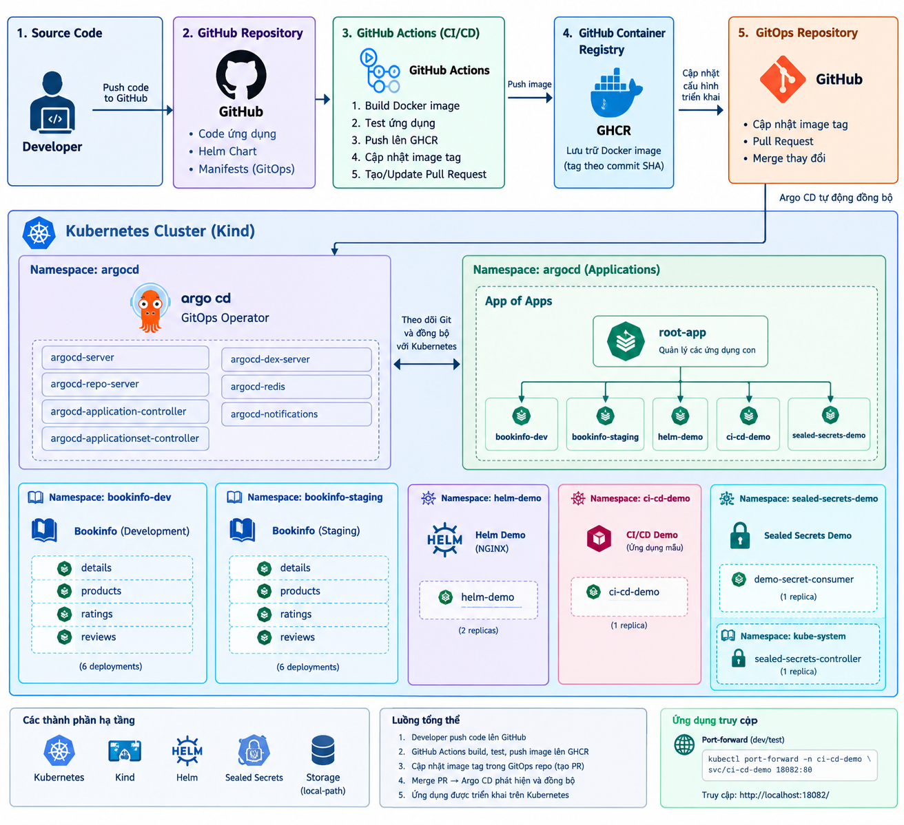

# Argo CD & Helm GitOps Lab

**Dự án thực hành DevOps xây dựng quy trình GitOps và CI/CD trên Kubernetes với Argo CD, Helm và GitHub Actions.**

## 1. Mục tiêu dự án

Dự án mô phỏng quy trình đưa một ứng dụng từ mã nguồn đến môi trường Kubernetes, đồng thời thực hành quản lý cấu hình triển khai bằng Git. Các mục tiêu chính:

- Triển khai ứng dụng Kubernetes bằng Argo CD theo mô hình GitOps.
- Quản lý nhiều ứng dụng thông qua mô hình **App of Apps**.
- Đóng gói cấu hình ứng dụng bằng Helm.
- Tách cấu hình giữa các môi trường Development và Staging.
- Tự động build và kiểm tra ứng dụng bằng GitHub Actions.
- Đẩy container image lên GitHub Container Registry (GHCR).
- Cập nhật image tag qua Pull Request để kiểm soát thay đổi triển khai.
- Thực hành mã hóa Kubernetes Secret bằng Sealed Secrets.
- Kiểm tra trạng thái ứng dụng và xử lý sự cố bằng `kubectl`, Helm và Argo CD.

## 2. Sơ đồ kiến trúc



Sơ đồ thể hiện các thành phần chính của lab: GitHub là nơi lưu mã nguồn và cấu hình GitOps; GitHub Actions tự động build, kiểm tra và phát hành image; GHCR lưu trữ image; Pull Request kiểm soát thay đổi cấu hình; Argo CD đồng bộ cấu hình từ Git xuống Kubernetes.

> Lưu ý: Sơ đồ là hình minh họa tổng quan. Khi trình bày portfolio, hãy đối chiếu số replica, tên Application, namespace và tên workflow với cấu hình hiện tại trong repository.

## 3. Luồng CI/CD và GitOps

Luồng triển khai được chia thành các giai đoạn sau:

1. **Thay đổi mã nguồn:** Developer chỉnh sửa ứng dụng và push commit lên GitHub.
2. **Chạy CI:** GitHub Actions được kích hoạt theo cấu hình workflow trong repository.
3. **Build và kiểm tra:** Pipeline build Docker image và chạy các bước kiểm tra được khai báo trong workflow.
4. **Phát hành image:** Khi các bước cần thiết thành công, image được đẩy lên GHCR. Image tag gắn với commit SHA giúp truy vết phiên bản mã nguồn.
5. **Cập nhật cấu hình GitOps:** Pipeline tạo hoặc cập nhật Pull Request để thay đổi image tag trong cấu hình triển khai.
6. **Review và merge:** Người quản lý xem xét thay đổi và merge Pull Request khi đạt yêu cầu.
7. **Argo CD đồng bộ:** Argo CD phát hiện commit mới trong Git và đồng bộ manifest/Helm Chart xuống Kubernetes.
8. **Kiểm chứng triển khai:** Kiểm tra trạng thái Application, Deployment, Pod, Service và endpoint của ứng dụng.

**Điểm quan trọng:** CI chịu trách nhiệm build và kiểm tra artifact; Git là nguồn khai báo trạng thái triển khai; Argo CD chịu trách nhiệm đồng bộ trạng thái đó vào Kubernetes. Việc tạo Pull Request không đồng nghĩa thay đổi đã được triển khai — thay đổi cần được merge và Argo CD cần đồng bộ thành công.

## 4. Công nghệ sử dụng

| Công nghệ | Vai trò |
|---|---|
| Kubernetes | Chạy và quản lý ứng dụng container |
| Kind | Tạo Kubernetes cluster phục vụ thực hành |
| Argo CD | GitOps continuous delivery |
| Helm | Đóng gói và cấu hình ứng dụng Kubernetes |
| GitHub Actions | Tự động hóa quy trình CI |
| Docker | Build container image |
| GitHub Container Registry (GHCR) | Lưu trữ container image |
| Sealed Secrets | Mã hóa Secret để quản lý an toàn hơn trong Git |
| Git và GitHub Pull Request | Quản lý phiên bản và review thay đổi |
| `kubectl` | Kiểm tra và quản trị tài nguyên Kubernetes |

## 5. Các lab trong repository

### 5.1. Argo CD App of Apps

Sử dụng một Application gốc để quản lý các Application con, giúp tổ chức triển khai tập trung và dễ mở rộng.

### 5.2. Bookinfo Development và Staging

Triển khai các thành phần Bookinfo trong những môi trường riêng biệt, thực hành quản lý microservice và cấu hình triển khai bằng Argo CD.

### 5.3. Helm demo

Sử dụng Helm Chart để định nghĩa Deployment và Service. Thực hành kiểm tra Chart và render Kubernetes manifest trước khi triển khai.

Các lệnh kiểm tra:

```bash
helm lint charts/helm-demo
helm template helm-demo charts/helm-demo
```

### 5.4. CI/CD demo

Workflow GitHub Actions tự động hóa build và kiểm tra ứng dụng, phát hành image lên GHCR và tạo/cập nhật Pull Request cho thay đổi image tag trong cấu hình GitOps. Argo CD triển khai phiên bản mới sau khi thay đổi được merge và đồng bộ.

Các vị trí cấu hình chính cần kiểm tra trong repository:

- Workflow: `.github/workflows/ci-cd-demo.yml`
- Helm Chart: `charts/ci-cd-demo/`
- Cấu hình ứng dụng: `apps/ci-cd-demo/`
- Argo CD Application: `ci-cd-demo`
- Namespace triển khai: `ci-cd-demo`

### 5.5. Sealed Secrets

Thực hành lưu tài nguyên SealedSecret đã mã hóa trong Git và để Sealed Secrets Controller tạo Kubernetes Secret trong cluster. Private key của controller cần được bảo vệ; không commit Secret dạng rõ hoặc thông tin xác thực vào repository.

## 6. Cấu trúc repository

```text
argocd-helm-lab/
├── .github/
│   └── workflows/
│       └── ci-cd-demo.yml
├── apps/
│   ├── ci-cd-demo/
│   └── sealed-secrets-demo/
├── bootstrap/
│   └── root-app.yaml
├── charts/
│   ├── ci-cd-demo/
│   └── helm-demo/
├── docs/
│   ├── images/
│   │   └── architecture.png
│   └── runbooks/
│       ├── helm-gitops.md
│       └── sealed-secrets.md
├── ci-cd-demo-app.yaml
├── helm-demo-app.yaml
├── sealed-secrets-controller.yaml
├── sealed-secrets-demo-app.yaml
└── README.md
```

Đây là cấu trúc tổng quan của các thành phần chính; hãy giữ sơ đồ này đồng bộ với cây thư mục thực tế trong repository.

## 7. Kiểm tra và xác minh

Các lệnh sau dùng để kiểm tra hệ thống sau khi cluster và Argo CD đã được cài đặt.

### Kiểm tra Argo CD Applications

```bash
kubectl get applications -n argocd
kubectl get application ci-cd-demo -n argocd
```

Trạng thái thường mong đợi sau khi triển khai thành công là `Synced` và `Healthy`.

### Kiểm tra workload của ứng dụng CI/CD demo

```bash
kubectl get deployment,pods,svc -n ci-cd-demo
kubectl rollout status deployment/ci-cd-demo -n ci-cd-demo
```

### Kiểm tra image đang được triển khai

```bash
kubectl get deployment ci-cd-demo \
  -n ci-cd-demo \
  -o jsonpath='{.spec.template.spec.containers[*].image}'

echo
```

### Kiểm tra ứng dụng qua port-forward

Mở terminal thứ nhất:

```bash
kubectl port-forward -n ci-cd-demo svc/ci-cd-demo 18082:80
```

Mở terminal thứ hai:

```bash
curl -fsS http://localhost:18082/
```

Nếu trả về nội dung HTML mong đợi, endpoint đang phản hồi. Đây là một bước kiểm tra riêng; để xác nhận toàn bộ CI/CD, cần kiểm tra thêm kết quả GitHub Actions, image trên GHCR, Pull Request đã merge và trạng thái đồng bộ của Argo CD.

### Kiểm tra Sealed Secrets

```bash
kubectl get sealedsecrets -n sealed-secrets-demo
kubectl get secrets -n sealed-secrets-demo
kubectl get pods -n sealed-secrets-demo
kubectl get events -n sealed-secrets-demo --sort-by=.lastTimestamp
```

Không in giá trị Secret ra log hoặc đưa dữ liệu nhạy cảm vào báo cáo công khai.

## 8. Troubleshooting cơ bản

| Hiện tượng | Hướng kiểm tra |
|---|---|
| Argo CD `OutOfSync` | Kiểm tra Git revision, manifest và cấu hình Application |
| Application `Degraded` | Kiểm tra Deployment, Pod, Events và log |
| `ImagePullBackOff` | Kiểm tra image name/tag, quyền truy cập GHCR và image pull secret |
| Helm Chart lỗi | Chạy `helm lint` và `helm template` |
| GitHub Actions thất bại | Mở tab Actions và xem log của bước lỗi |
| Pull Request chưa được merge | Kiểm tra trạng thái review và branch đích |
| SealedSecret chưa tạo Secret | Kiểm tra controller, namespace, key mã hóa và Events |
| Endpoint không phản hồi | Kiểm tra Service selector, Pod readiness, port và port-forward |

## 9. Kỹ năng thể hiện qua dự án

- Kubernetes workload và Service management.
- GitOps với Argo CD và mô hình App of Apps.
- Helm chart authoring và manifest validation.
- CI/CD automation với GitHub Actions.
- Container image versioning và GHCR.
- Git-based change review bằng Pull Request.
- Quản lý Secret với Sealed Secrets.
- Kiểm tra trạng thái triển khai và troubleshooting.

