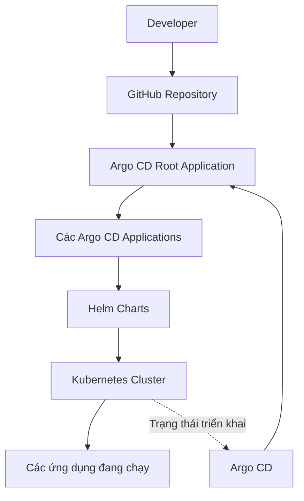
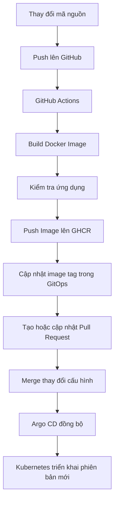

# Argo CD & Helm GitOps Lab

**Dự án thực hành DevOps: triển khai ứng dụng Kubernetes theo mô hình GitOps với Argo CD, Helm và GitHub Actions.**

Repository này ghi lại quá trình xây dựng một môi trường Kubernetes lab nhằm thực hành triển khai ứng dụng, quản lý cấu hình bằng Git, tự động hóa CI/CD và bảo mật thông tin nhạy cảm trong Kubernetes.

## 1. Mục tiêu dự án

Dự án được xây dựng nhằm thực hành các kỹ năng DevOps thông qua những tình huống triển khai gần với môi trường thực tế:

- Triển khai và quản lý ứng dụng Kubernetes bằng Argo CD.
- Sử dụng mô hình **App of Apps** để quản lý nhiều Argo CD Application.
- Đóng gói ứng dụng bằng Helm Chart.
- Tách biệt cấu hình giữa môi trường Development và Staging.
- Xây dựng pipeline CI/CD bằng GitHub Actions.
- Build Docker image, kiểm tra ứng dụng và đẩy image lên GitHub Container Registry (GHCR).
- Tự động cập nhật cấu hình triển khai thông qua GitOps Pull Request.
- Sử dụng Sealed Secrets để quản lý dữ liệu nhạy cảm trong Git.
- Kiểm tra trạng thái triển khai và xử lý sự cố bằng `kubectl`, Helm và Argo CD.

## 2. Kiến trúc hệ thống

### 2.1. Kiến trúc GitOps



GitHub đóng vai trò là nguồn quản lý mã nguồn và cấu hình triển khai. Argo CD theo dõi repository, phát hiện thay đổi và đồng bộ trạng thái thực tế của Kubernetes với trạng thái được khai báo trong Git.

### 2.2. Luồng CI/CD



Pipeline giúp tự động hóa quá trình xây dựng và phát hành ứng dụng. Việc thay đổi cấu hình triển khai được quản lý qua Git, cho phép xem xét thay đổi trước khi merge và để Argo CD thực hiện đồng bộ.

## 3. Công nghệ sử dụng

| Công nghệ | Vai trò |
|---|---|
| Kubernetes | Nền tảng chạy và quản lý ứng dụng container |
| Kind | Tạo Kubernetes cluster phục vụ thực hành |
| Argo CD | Triển khai ứng dụng theo mô hình GitOps |
| Helm | Đóng gói và quản lý cấu hình ứng dụng |
| GitHub Actions | Tự động hóa quy trình CI/CD |
| Docker | Đóng gói ứng dụng thành container image |
| GitHub Container Registry | Lưu trữ Docker image |
| Sealed Secrets | Mã hóa Secret để có thể quản lý an toàn hơn trong Git |
| kubectl | Kiểm tra và quản trị tài nguyên Kubernetes |
| Git | Quản lý phiên bản mã nguồn và cấu hình |

## 4. Các nội dung đã triển khai

### 4.1. Quản lý ứng dụng bằng Argo CD App of Apps

Xây dựng Application gốc để quản lý các Application con trong cluster.

Nội dung thực hành:

- Khai báo ứng dụng bằng YAML.
- Tổ chức cấu hình triển khai trong Git repository.
- Quản lý nhiều Application thông qua một Application gốc.
- Theo dõi trạng thái `Synced` và `Healthy`.
- Kiểm tra trạng thái đồng bộ giữa Git và Kubernetes.

### 4.2. Triển khai Bookinfo trên nhiều môi trường

Triển khai các thành phần của ứng dụng Bookinfo và tổ chức cấu hình cho môi trường Development, Staging.

Mục tiêu:

- Thực hành triển khai nhiều microservice.
- Quản lý tài nguyên thông qua Argo CD.
- Tổ chức cấu hình theo từng môi trường.
- Kiểm tra trạng thái Deployment, Pod và Service.

### 4.3. Triển khai ứng dụng bằng Helm

Sử dụng Helm Chart để đóng gói cấu hình triển khai ứng dụng NGINX.

Các nội dung thực hành:

- Xây dựng `Chart.yaml` và `values.yaml`.
- Khai báo Deployment và Service trong thư mục `templates/`.
- Kiểm tra cú pháp bằng `helm lint`.
- Render manifest bằng `helm template`.
- Kết hợp Helm với Argo CD để quản lý quá trình triển khai.

Ứng dụng được quản lý trong namespace `helm-demo`.

### 4.4. Xây dựng pipeline CI/CD với GitHub Actions

Xây dựng pipeline tự động hóa cho ứng dụng CI/CD demo.

Quy trình bao gồm:

1. Tiếp nhận thay đổi mã nguồn trên GitHub.
2. Chạy workflow GitHub Actions.
3. Build Docker image.
4. Thực hiện bước kiểm tra ứng dụng.
5. Đẩy image lên GitHub Container Registry.
6. Cập nhật image tag trong cấu hình GitOps.
7. Tạo hoặc cập nhật Pull Request cho thay đổi triển khai.
8. Sau khi thay đổi được merge, Argo CD đồng bộ cấu hình mới xuống Kubernetes.

Image được quản lý theo tag gắn với commit, ví dụ `sha-<commit-sha>`, giúp xác định phiên bản mã nguồn tương ứng với image được triển khai.

Các thành phần chính:

- Workflow: `.github/workflows/ci-cd-demo.yml`
- Helm Chart: `charts/ci-cd-demo/`
- Cấu hình ứng dụng: `apps/ci-cd-demo/`
- Argo CD Application: `ci-cd-demo`
- Namespace: `ci-cd-demo`
- Container registry: GitHub Container Registry

### 4.5. Quản lý Secret với Sealed Secrets

Thực hành quản lý dữ liệu nhạy cảm trong Kubernetes thông qua Sealed Secrets.

Luồng xử lý:

1. Tạo Kubernetes Secret chứa dữ liệu cần bảo vệ.
2. Mã hóa Secret thành tài nguyên SealedSecret.
3. Lưu cấu hình SealedSecret vào Git.
4. Argo CD đồng bộ tài nguyên lên Kubernetes.
5. Sealed Secrets Controller giải mã và tạo Kubernetes Secret tương ứng.
6. Ứng dụng sử dụng Secret thông qua cấu hình Kubernetes.

Controller được triển khai trong namespace `kube-system`; ứng dụng demo được tổ chức trong namespace `sealed-secrets-demo`.

**Lưu ý bảo mật:** Sealed Secrets giúp giảm nguy cơ lưu Secret dạng rõ trong Git, nhưng không thay thế việc bảo vệ private key, phân quyền truy cập cluster và quản lý thông tin xác thực.

## 5. Cấu trúc repository

```text
argocd-helm-lab/
├── .github/
│   └── workflows/
│       └── ci-cd-demo.yml
├── apps/
│   ├── ci-cd-demo/
│   └── sealed-secrets-demo/
├── bootstrap/
│   └── root-app.yaml
├── charts/
│   ├── ci-cd-demo/
│   └── helm-demo/
├── docs/
│   └── runbooks/
│       ├── helm-gitops.md
│       └── sealed-secrets.md
├── ci-cd-demo-app.yaml
├── helm-demo-app.yaml
├── sealed-secrets-controller.yaml
├── sealed-secrets-demo-app.yaml
└── README.md
```

Đây là cấu trúc tổng quan của các thành phần chính. Một số thư mục có thể chứa thêm manifest và template phục vụ triển khai.

## 6. Kiểm tra hệ thống

Các lệnh dưới đây dùng để kiểm tra những thành phần đã triển khai. Cần chạy trên máy có `kubectl`, Helm và quyền truy cập Kubernetes cluster.

### 6.1. Kiểm tra Argo CD Application

```bash
kubectl get applications -n argocd
```

Kiểm tra riêng ứng dụng CI/CD demo:

```bash
kubectl get application ci-cd-demo -n argocd
```

Trạng thái mong đợi khi triển khai thành công:

- `Synced`: cấu hình triển khai đã đồng bộ với Git.
- `Healthy`: tài nguyên được Argo CD đánh giá là khỏe mạnh.

### 6.2. Kiểm tra tài nguyên Kubernetes

```bash
kubectl get deployment,pods,svc -n ci-cd-demo
```

Kiểm tra quá trình rollout:

```bash
kubectl rollout status deployment/ci-cd-demo -n ci-cd-demo
```

Kiểm tra image đang được Deployment sử dụng:

```bash
kubectl get deployment ci-cd-demo \
  -n ci-cd-demo \
  -o jsonpath='{.spec.template.spec.containers[*].image}'

echo
```

### 6.3. Kiểm tra Helm Chart

```bash
helm lint charts/helm-demo
helm template helm-demo charts/helm-demo
```

Hai lệnh này giúp phát hiện lỗi cơ bản trong Chart và kiểm tra manifest được sinh ra trước khi triển khai.

### 6.4. Kiểm tra ứng dụng qua port-forward

Mở một terminal và chạy:

```bash
kubectl port-forward -n ci-cd-demo \
  svc/ci-cd-demo 18082:80
```

Mở terminal khác:

```bash
curl -fsS http://localhost:18082/
```

Nếu ứng dụng trả về HTML mong đợi, có thể xác nhận endpoint đang phản hồi nội dung ứng dụng.

### 6.5. Kiểm tra Sealed Secrets

```bash
kubectl get sealedsecrets -n sealed-secrets-demo
kubectl get secrets -n sealed-secrets-demo
kubectl get pods -n sealed-secrets-demo
```

Kiểm tra sự kiện khi cần xử lý sự cố:

```bash
kubectl get events -n sealed-secrets-demo \
  --sort-by=.lastTimestamp
```

Không in giá trị Secret lên terminal hoặc đưa dữ liệu nhạy cảm vào log công khai.

## 7. Hướng dẫn bắt đầu

### Yêu cầu môi trường

- Git
- Docker
- Kind hoặc Kubernetes cluster tương đương
- kubectl
- Helm
- Argo CD
- Tài khoản GitHub
- Quyền truy cập repository và GHCR phù hợp

### Các bước thực hiện

**Bước 1: Clone repository**

```bash
git clone https://github.com/hoang4325/argocd-helm-lab.git
cd argocd-helm-lab
```

**Bước 2: Kiểm tra cấu trúc mã nguồn**

```bash
find . -maxdepth 4 -type f | sort
```

**Bước 3: Kiểm tra Helm Chart**

```bash
helm lint charts/helm-demo
helm template helm-demo charts/helm-demo
```

**Bước 4: Kiểm tra kết nối Kubernetes**

```bash
kubectl cluster-info
kubectl get nodes
```

**Bước 5: Kiểm tra Argo CD và ứng dụng**

Nếu cluster đã được cấu hình và các Application đã triển khai:

```bash
kubectl get applications -n argocd
kubectl get pods -A
```

> Lưu ý: Clone repository không tự động tạo Kubernetes cluster hoặc cài đặt toàn bộ hệ thống. Cần cấu hình cluster, Argo CD, quyền truy cập Git và các thành phần phụ thuộc trước khi triển khai.

## 8. Xử lý sự cố

| Hiện tượng | Hướng kiểm tra |
|---|---|
| Application `OutOfSync` | Kiểm tra manifest trong Git và trạng thái đồng bộ Argo CD |
| Application `Degraded` | Kiểm tra Pod, Deployment, Events và log ứng dụng |
| Pod `ImagePullBackOff` | Kiểm tra image name, tag, registry và quyền pull image |
| Helm Chart lỗi | Chạy `helm lint` và `helm template` |
| Pipeline GitHub Actions thất bại | Xem log từng bước trong tab Actions |
| Pull Request cập nhật image chưa được merge | Kiểm tra trạng thái PR và branch đích |
| SealedSecret không tạo được Secret | Kiểm tra controller, namespace, key mã hóa và Events |
| Endpoint không phản hồi | Kiểm tra Service, selector, Pod và port-forward |

## 9. Kết quả và kỹ năng thực hành

Dự án tập trung vào các kỹ năng:

- **Kubernetes:** quản lý Deployment, Pod, Service, Namespace và Secret.
- **GitOps:** khai báo trạng thái mong muốn trong Git và đồng bộ bằng Argo CD.
- **Helm:** đóng gói, cấu hình và kiểm tra ứng dụng.
- **CI/CD:** tự động hóa build, kiểm tra và phát hành image.
- **Container Registry:** quản lý image trên GHCR.
- **Bảo mật:** thực hành mã hóa Secret bằng Sealed Secrets.
- **Troubleshooting:** sử dụng `kubectl`, Helm, log và Events để kiểm tra hệ thống.
- **Quản lý thay đổi:** sử dụng Git và Pull Request để kiểm soát thay đổi cấu hình triển khai.

